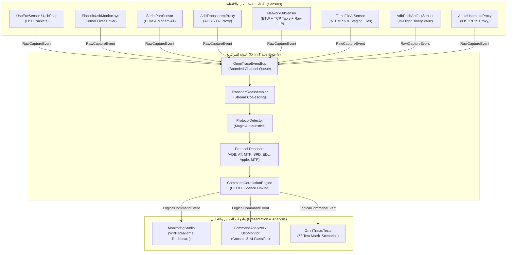

# 🗺️ الدليل الشامل وخارطة مشروع PhoenixGSM Monitoring Toolkit
> **دليل المطورين والمهندسين للصيانة والتطوير السريع دون الحاجة لإعادة قراءة المشروع بالكامل**

---

## 📑 فهرس المحتويات
1. [نظرة عامة على المشروع وأهدافه](#1-نظرة-عامة-على-المشروع-وأهدافه)
2. [المخطط المعماري الشامل وتدفق البيانات (System Architecture)](#2-المخطط-المعماري-الشامل-وتدفق-البيانات-system-architecture)
3. [خارطة المشاريع والمجلدات الرئيسية (Solution Map)](#3-خارطة-المشاريع-والمجلدات-الرئيسية-solution-map)
4. [دليل الملفات والوظائف التفصيلي (File-by-File Reference)](#4-دليل-الملفات-والوظائف-التفصيلي-file-by-file-reference)
   - [أولاً: نواة التتبع PhoenixOmniTrace](#أولاً-نواة-التتبع-phoenixomnitrace)
   - [ثانياً: مراقب وتعاريف اليو إس بي UsbMonitor](#ثانياً-مراقب-وتعاريف-اليو-إس-بي-usbmonitor)
   - [ثالثاً: الواجهة الرسومية MonitoringStudio](#ثالثاً-الواجهة-الرسومية-monitoringstudio)
   - [رابعاً: محلل الأنماط والذكاء الاصطناعي CommandAnalyzer](#رابعاً-محلل-الأنماط-والذكاء-الاصطناعي-commandanalyzer)
   - [خامساً: باقي المشاريع الفرعية (AdbMonitor, ProcessMonitor, SerialSniffer, Discovery)](#خامساً-باقي-المشاريع-الفرعية)
   - [سادساً: حزمة الاختبارات المؤتمتة PhoenixOmniTrace.Tests](#سادساً-حزمة-الاختبارات-المؤتمتة-phoenixomnitracetests)
5. [توثيق إعادة تقسيم الملفات الضخمة (Modular Architecture)](#5-توثيق-إعادة-تقسيم-الملفات-الضخمة-modular-architecture)
6. [دليل الصيانة والتطوير السريع (Developer Cheat Sheet)](#6-دليل-الصيانة-والتطوير-السريع-developer-cheat-sheet)

---

## 1. نظرة عامة على المشروع وأهدافه

مشروع **PhoenixGSM Monitoring Toolkit** هو منظومة متقدمة ومكتملة تعمل على بيئة ويندوز (Windows Kernel & User-Mode) لمراقبة، اعتراض، تفكيك، وتحليل حركة الاتصالات الخاصة بأجهزة الهواتف المحمولة وبرامج الصيانة والفك الاحتكاري (GSM Servicing & Unlock Tools).

### القدرات الأساسية:
- **الاعتراض المتعدد (Multi-Vector Capture):** اعتراض حركة USB على مستوى الكيرنل (Kernel Filter Driver) و ETW، المنافذ التسلسلية (COM / Modem)، شبكة TCP/IP، وكيل ADB الذكي، الملفات المؤقتة (%TEMP%\AT)، والحافظة (Clipboard).
- **التفكيك التلقائي للبروتوكولات (Multi-Vendor Protocol Decoders):** فك شفرات وحزم بروتوكولات:
  - **Android ADB & Fastboot** (Wire Protocol, Smart Sockets, Sync Protocol).
  - **Serial AT & Modem** (مودمات سامسونج، كوالكوم، هواوي، أوامر AT، وحقن RIL).
  - **MediaTek (MTK)** (حزم BROM و DA).
  - **Unisoc / Spreadtrum (SPD)** (حزم FDL1 و FDL2).
  - **Qualcomm EDL 9008** (حزم Sahara و Firehose XML).
  - **Apple iOS** (بروتوكولات Usbmuxd, Lockdown, Recovery Mode, DFU Mode, Purple Diag, Ramdisk SSH).
  - **MTP / PTP** (عمليات نقل الملفات والبيانات).
- **محرك الربط والنسبة (Correlation & Process Attribution):** ربط الحزم الخام بأوامر منطقية وتحديد المعرف البرمجي (PID) واسم البرنامج المنفذ عبر Windows Restart Manager و ETW.
- **الحماية والصمود (Fail-Open & Stealth Resilience):** تشغيل آمن ومستمر لا يعطل برامج النظام حتى عند حدوث أخطاء، مع دروع ضد الإغلاق القسري (Process Guardian).

---

## 2. المخطط المعماري الشامل وتدفق البيانات (System Architecture)



---

## 3. خارطة المشاريع والمجلدات الرئيسية (Solution Map)

يقع حل المشروعات داخل المجلد:
`PhoenixGSM\tools\MonitoringToolkit\PhoenixGSM.Monitor.sln`

| المشروع | نوع المشروع | المسار | الدور والوظيفة |
| :--- | :--- | :--- | :--- |
| **PhoenixOmniTrace** | Class Library (net8.0) | `tools\MonitoringToolkit\PhoenixOmniTrace` | المحرك المركزي، خط الأنابيب، الحساسات، والمفككات |
| **UsbMonitor** | WinExe Console (net8.0-windows) | `tools\MonitoringToolkit\UsbMonitor\UsbMonitor` | مدير تعريف الكيرنل وتثبيت الفلاتر وسطر الأوامر |
| **PhoenixUsbMonitor** | C++ Kernel Driver (WDM) | `tools\MonitoringToolkit\UsbMonitor\PhoenixUsbMonitor` | فلتر كيرنل ويندوز (Lower/Upper Filter) للـ USB |
| **UsbMonitorDiscovery** | Class Library (net8.0-windows) | `tools\MonitoringToolkit\UsbMonitor\UsbMonitorDiscovery` | فحص توبولوجيا USB و PnP وتحديد أنواع الهواتف |
| **MonitoringStudio** | WPF Desktop App (net8.0-windows) | `tools\MonitoringToolkit\MonitoringStudio` | لوحة التحكم الرسومية المباشرة (GUI Dashboard) |
| **CommandAnalyzer** | Console (net8.0) | `tools\MonitoringToolkit\CommandAnalyzer` | تحليل الحزم والربط مع الذكاء الاصطناعي وتصنيف الأنماط |
| **AdbMonitor** | Console (net8.0) | `tools\MonitoringToolkit\AdbMonitor` | مراقب ووكيل خفيف مستقل لحزم ADB |
| **SerialSniffer** | Console (net8.0) | `tools\MonitoringToolkit\SerialSniffer` | أداة مستقلة للتنصت على منافذ COM |
| **ProcessMonitor** | Console (net8.0) | `tools\MonitoringToolkit\ProcessMonitor` | أداة تتبع العمليات التنفيذية عبر ETW |
| **PhoenixOmniTrace.Tests** | Exe (net8.0-windows) | `tools\MonitoringToolkit\PhoenixOmniTrace.Tests` | 53 سيناريو اختبار معماري ووظيفي شامل |

---

## 4. دليل الملفات والوظائف التفصيلي (File-by-File Reference)

### أولاً: نواة التتبع PhoenixOmniTrace

#### 1. مسار النواة ومحرك الأحداث (`Bus/`, `Correlation/`, `Reassembly/`, `Detection/`):
- `Bus\OmniTraceEventBus.cs`:
  - **الوظيفة:** العمود الفقري لتبادل الأحداث بين الحساسات والمفككات باستخدام قنوات غير حاجزة `Channel<RawCaptureEvent>`.
  - **أهم الدوال:** `Publish()`, `ProcessEventsAsync()`, `ProcessSingleEvent()`, `GetMetrics()`, `Flush()`.
- `Bus\OmniTraceEventBus.Decoders.cs`:
  - **الوظيفة:** استدعاء وتوجيه الحزم لمفكك البروتوكول المناسب.
  - **أهم الدوال:** `DecodeAdbStream()`, `DecodeSerialAtStream()`, `DecodeMtkStream()`, `DecodeSpdFdlStream()`, `DecodeQualcommEdlStream()`, `DecodeAppleStream()`, `DecodeHostCommandStream()`.
- `Reassembly\TransportReassembler.cs`:
  - **الوظيفة:** إعادة تجميع الحزم المقسمة وتوحيد التدفق (Stream Reassembly) وحل حدود الإطارات.
  - **أهم الدوال:** `PushRawEvent()`, `PeekStream()`, `ConsumeStream()`, `GetEvidenceSnapshot()`.
- `Detection\ProtocolDetector.cs`:
  - **الوظيفة:** التعرف الآلي على البروتوكول من خلال التواقيع الرقمية (Magic Bytes) والقواعد الاستدلالية.
  - **أهم الدوال:** `GetBestCandidate()`, `DetectFromPayload()`.
- `Correlation\CommandCorrelationEngine.cs`:
  - **الوظيفة:** تحويل الحزم الخام إلى أوامر منطقية `LogicalCommandEvent` وربطها بالعمليات المنفذة وأدلة التسلسل.
  - **أهم الدوال:** `Correlate()`, `RegisterProcess()`.

#### 2. مسار الحساسات (Sensors/):
- `Sensors\TempFileAtSensor.cs`:
  - **الوظيفة:** الفئة الأساسية لحساس الملفات المؤقتة، إدارة الـ FileSystemWatcher والمسارات الافتراضية.
  - **أهم الدوال:** `Start()`, `Stop()`, `AddWatchDirectory()`, `ScanExistingStagedFiles()`.
- `Sensors\TempFileAtSensor.Parser.cs`:
  - **الوظيفة:** تفكيك واستخراج أوامر AT من النصوص المشفرة أو الهيكس واكتشاف الصيغ الثنائية واستخراج السلاسل النصية.
  - **أهم الدوال:** `ExtractAtCommands()`, `IsAtCommand()`, `DecodeText()`, `IsBinaryBuffer()`, `ExtractPrintableStrings()`, `IdentifyBinaryFormat()`.
- `Sensors\TempFileAtSensor.Attribution.cs`:
  - **الوظيفة:** نسبة الملف للعملية المنشئة باستخدام واجهة ويندوز الرسمية (Restart Manager API - `rstrtmgr.dll`).
  - **أهم الدوال:** `AttributeCreatingProcess()`, `QueryProcessLockingFile()`, `IsKnownGsmTool()`.
- `Sensors\TempFileAtSensor.Ingestion.cs`:
  - **الوظيفة:** معالجة البيانات المحقونة وإرسال أحداث الملفات إلى خط الأنابيب، ومحاكاة الاختبارات.
  - **أهم الدوال:** `ProcessFileBytesDirect()`, `IngestCapturedTempFile()`, `SimulateTempFileAtCapture()`.
- `Sensors\TempFileAtEvent.cs`:
  - **الوظيفة:** نموذج بيانات الحدث للملف المؤقت المعترض.
- `Sensors\NetworkUrlSensor.cs`:
  - **الوظيفة:** الفئة الأساسية لحساس شبكة الإنترنت والروابط، إدارة الجلسات والمتغيرات.
  - **أهم الدوال:** `Start()`, `Stop()`, `Dispose()`.
- `Sensors\NetworkUrlSensor.Etw.cs`:
  - **الوظيفة:** اعتراض طلبات الشبكة عبر مزودي ETW (WinHTTP, WinINet, WebIO, DNS-Client, HttpClient).
  - **أهم الدوال:** `StartEtwSession()`, `HandleTraceEvent()`, `ExtractFromWinHttp()`, `ExtractFromDnsClient()`.
- `Sensors\NetworkUrlSensor.TcpWatcher.cs`:
  - **الوظيفة:** مراقبة اتصالات TCP الحية ونسبتها للعمليات عبر `GetExtendedTcpTable` في `iphlpapi.dll`.
  - **أهم الدوال:** `PollActiveTcpConnections()`, `TcpConnectionWatcherLoop()`.
- `Sensors\NetworkUrlSensor.RawSniffer.cs`:
  - **الوظيفة:** التنصت العشوائي على حزم IP لاستخراج طلبات HTTP الصريحة ونطاقات HTTPS من حزمة TLS ClientHello SNI.
  - **أهم الدوال:** `ProcessRawIpPacket()`, `ExtractSni()`, `MatchesHttpVerb()`.
- `Sensors\NetworkUrlSensor.Ingestion.cs`:
  - **الوظيفة:** معالجة الروابط ومنع التكرار ونسبة العمليات وتنسيق البيانات.
  - **أهم الدوال:** `IngestCapturedUrl()`, `ResolveProcessName()`, `SimulateUrlCapture()`.
- `Sensors\CapturedUrlInfo.cs`:
  - **الوظيفة:** نموذج بيانات الرابط الملتقط وتفاصيل الاتصال.
- `Sensors\UsbEtwSensor.cs`:
  - **الوظيفة:** اعتراض حزم USB في الوقت الحقيقي عبر مزودي ETW لـ Microsoft-Windows-USB-USBPORT و USBHUB3.
- `Sensors\SerialPortSensor.cs`:
  - **الوظيفة:** اكتشاف ومراقبة منافذ COM والمودم والتنصت على أوامر AT التبادلية.
- `Sensors\AdbPushArtifactSensor.cs` & `Sensors\AdbPushArtifactVault.cs`:
  - **الوظيفة:** استعادة الملفات المنقولة عبر أمر `adb push` وتخزين نسخ منها (Artifact Vault) لمنع حذفها التلقائي من أدوات الفك.
- `Sensors\ClipboardUrlSensor.cs`:
  - **الوظيفة:** مراقبة حافظة ويندوز بحثاً عن روابط التنزيل ومفاتيح السيرفرات المستخدمة في برامج الـ GSM.
- `Sensors\InProcessExecutionSensor.cs`:
  - **الوظيفة:** اعتراض الأوامر والعمليات المنفذة داخلياً في نفس العملية.

#### 3. مسار مفككات البروتوكولات (Decoders/):
- `Decoders\AdbWireDecoder.cs`: فك حزم بروتوكول السلك ADB (SYNC, CNXN, OPEN, WRTE, OKAY, CLSE).
- `Decoders\AdbSmartSocketDecoder.cs`: فك حزم مقابس ADB المحلية (Smart Sockets).
- `Decoders\ShellStreamReconstructor.cs`: إعادة بناء جلسات الشل التفاعلية وفصل أوامر الإدخال (>>) عن المخرجات (<<).
- `Decoders\MtkProtocolDecoder.cs`: فك حزم معالجات ميديا تك (Handshake, Read32, Write32, DA Jump).
- `Decoders\SpdFdlDecoder.cs`: فك حزم معالجات سبريدترم / يونيسوك (HDLC Framing, FDL Connect, Download).
- `Decoders\QualcommEdlDecoder.cs`: فك حزم كوالكوم في وضع الطوارئ 9008 (Sahara Hello/Command و Firehose XML).
- `Decoders\MtpDecoder.cs`: فك شفرة بروتوكول نقل الوسائط والصور MTP/PTP.
- `Decoders\SmartContentClassifier.cs`: الفحص الذكي لأنواع الملفات المحقونة (ELF, APK, DEX, Shell Scripts).

#### 4. مسار دعم أجهزة آبل (Apple/):
- `Apple\Decoders\AppleUsbmuxdDecoder.cs`: تفكيك اتصالات Usbmuxd والرسائل بصيغة Plist و JSON.
- `Apple\Decoders\AppleLockdownDecoder.cs`: تفكيك رسائل وضع Lockdown والمعلومات المستخرجة من أجهزة iOS.
- `Apple\Decoders\AppleRecoveryDecoder.cs`: تفكيك أوامر وضع الاسترداد (iBoot / irecovery).
- `Apple\Decoders\AppleDfuDecoder.cs`: تتبع أوامر وضع DFU وثغرات SecureROM و checkm8.
- `Apple\Decoders\AppleRamdiskSshDecoder.cs`: تتبع اتصالات وأوامر كسر الحماية عبر Ramdisk SSH.
- `Apple\Decoders\ApplePurpleDiagDecoder.cs`: تفكيك أوامر الشاشة البنفسجية وتشخيص الـ SysCfg عبر المنافذ التسلسلية.
- `Apple\Sensors\AppleRamdiskSessionWatcher.cs`: مراقبة وتوثيق خطوات جلسات الـ Ramdisk ومجلدات العمل.
- `Apple\Sensors\AppleUsbmuxdProxy.cs`: وكيل وسيط شفاف لمنفذ Usbmuxd (27015).

---

### ثانياً: مراقب وتعاريف اليو إس بي UsbMonitor

- `DriverManager.cs`:
  - **الوظيفة:** تعريف الفئة الأساسية، الثوابت، معرفات الـ GUID للفئات المعروفة، وتحديد مسار ملف الكيرنل `PhoenixUsbMonitor.sys`.
  - **أهم الدوال:** `ResolveClassGuid()`, `GetDriverSysPath()`, `IsTestSigningEnabled()`, `IsServiceInstalled()`, `GetServiceStatus()`.
- `DriverManager.Service.cs`:
  - **الوظيفة:** إدارة دورة حياة خدمة الكيرنل عبر واجهة Service Control Manager (`sc.exe`).
  - **أهم الدوال:** `InstallService()`, `StartService()`, `StopService()`, `UninstallService()`.
- `DriverManager.ClassFilters.cs`:
  - **الوظيفة:** إدارة فلاتر الفئات (Class UpperFilters & LowerFilters) في الريجستري وإعادة تشغيل الأجهزة النشطة.
  - **أهم الدوال:** `ConfigureLowerFilter()`, `RemoveLowerFilter()`, `ConfigureUpperFilter()`, `RemoveUpperFilter()`, `RestartActiveDevicesOfClass()`, `ConfigurePortAndModemFilters()`.
- `DriverManager.DeviceFilters.cs`:
  - **الوظيفة:** الربط الجراحي للفلاتر بجهاز محدد بعينه (Device Instance Filters) دون التأثير على باقي الأجهزة.
  - **أهم الدوال:** `AttachDeviceLowerFilter()`, `DetachDeviceLowerFilter()`, `AttachDeviceUpperFilter()`, `DetachDeviceUpperFilter()`, `RestartDevice()`.
- `DriverManager.Rollback.cs`:
  - **الوظيفة:** الفحص الشامل لجميع الفلاتر المرتبطة واسترجاع إعدادات المصنع لويندوز (Rollback / Restore Stock).
  - **أهم الدوال:** `GetActiveFilterAttachments()`, `RemoveAllFilters()`, `RestoreStockWindowsConfiguration()`, `ShowStatus()`.
- `UsbDriverClient.cs`:
  - **الوظيفة:** العميل البرمجي في User-Mode للتواصل مع تعريف الكيرنل عبر DeviceIoControl وقراءة الحزم الملتقطة.
- `Protocol\AdbProtocolParser.cs`:
  - **الوظيفة:** تحليل حزم الـ USB الخام للتعرف على حزم ADB واستخراج الأوامر المنفذة.

---

### ثالثاً: الواجهة الرسومية MonitoringStudio

- `ViewModels\MainViewModel.cs`:
  - **الوظيفة:** الـ ViewModel الرئيسي للوحة التحكم، يربط البيانات بالواجهة ويدير الأوامر وحالة النظام.
  - **التحكم بمجسات الالتقاط الجزئية (Granular Capture Sensors):** خصائص تشغيل وإيقاف كل مجس على حدة (`IsUsbMonitoringEnabled`, `IsAdbMonitoringEnabled`, `IsSerialMonitoringEnabled`, `IsProcessMonitoringEnabled`, `IsUrlMonitoringEnabled`, `IsTempAtMonitoringEnabled`, `IsAppleMonitoringEnabled`, `IsArtifactVaultEnabled`, `IsMtpMonitoringEnabled`).
  - **مستثنيات العرض والتصدير (Exclusion Filters):** خصائص إخفاء السجلات من الجدول والتصدير (`HideUrls`, `HideAdb`, `HideUsb`, `HideSerial`, `HideProcesses`, `HideTempAt`, `HideApple`, `HideMtp`, `HideArtifacts`) مع عدادات فورية (`VisibleEventsCount`, `HiddenEventsCount`, `ExclusionBadgeText`).
- `ViewModels\MainViewModel.Events.cs`:
  - **الوظيفة:** استقبال وتصنيف الأحداث، إدارة العدادات، تصفية الجدول والبحث، واستثناء السجلات، وحذف السجلات.
  - **أهم الدوال:**
    - `HandleEventReceived()`: استقبال الأحداث من المحرك مع تحديث عدادات المعروض والمستثنى لحظياً.
    - `FilterEventPredicate()`: مطابقة الحدث مع فلاتر الاستبعاد المحددة أولاً (إخفاء الفئات المستثناة)، ثم فلتر التبويب المختار، ثم نص البحث.
    - `ClearLogs()`: تصفير السجلات والعدادات.
- `ViewModels\MainViewModel.Actions.cs`:
  - **الوظيفة:** معالجة الإجراءات التفاعلية (بدء/إيقاف، إرسال أوامر فحص الهاتف، فتح مدير الفلاتر، تصدير السجلات بدون المستثناة، وتشغيل المحلل الذكي).
  - **أهم الدوال:**
    - `ExportLogs()`: تصدير السجلات الظاهرة فقط (`FilteredEvents.Cast<LiveEventItem>()`) مع استبعاد كامل لجميع السجلات المخفية والمستثناة، ودعم صيغتي TXT و JSON.
    - `ToggleMonitoring()`, `QueryPhoneLiveAsync()`, `OpenFilterManager()`, `AnalyzeWithAiAsync()`.
- `ViewModels\RelayCommand.cs`:
  - **الوظيفة:** تطبيق نمط `ICommand` لربط أزرار الواجهة بالدوال البرمجية.
- `Services\MonitoringEngine.cs`:
  - **الوظيفة:** المحرك الوسيط بين الواجهة الرسومية وخدمات OmniTrace و UsbMonitor. يحتوي على أعلام تفعيل/تعطيل المجسات وفلترة مبكرة للحزم في `EmitEvent()` وداخل معالجات المجسات.
- `Views\UsbFilterManagerWindow.xaml.cs`:
  - **الوظيفة:** نافذة إدارة فلاتر التعريف وأجهزة الـ USB المتصلة وحالة Test Signing.
- `MainWindow.xaml`:
  - **التصميم الاحترافي:** واجهة Dark Cyber Forensic مقسمة إلى 6 طبقات مدروسة:
    1. شريط العنوان والعمليات الرئيسية مع شارة الحالة الحية.
    2. بطاقات القياس والعتاد (تعريف USB، الأجهزة المتصلة، المنافذ التسلسلية، الأدوات النشطة).
    3. لوحة التحكم بمجسات الالتقاط النشطة (مفاتيح تشغيل/إيقاف لكل مجس مع أزرار تشغيل/إيقاف الكل).
    4. شريط الفلاتر ومستثنيات العرض والتصدير (تبويبات الفئات مع العدادات، حقل البحث الفوري، وشارات استثناء وإخفاء السجلات مع زر إلغاء الاستثناءات).
    5. جدول التدفق الحي ومحلل الحزم (Hex Dump و ASCII وفاحص البيانات الوصفية).
    6. شريط الحالة السفلي (إجمالي السجلات، المعروض، المستثنى والمخفي، حالة الربط).

---

### رابعاً: محلل الأنماط والذكاء الاصطناعي CommandAnalyzer

- `PatternAnalyzer.cs`:
  - **الوظيفة:** تحليل تسلسل الأوامر لاكتشاف الأنماط المشبوهة أو عمليات الصيانة المعروفة (FRP Bypass, IMEI Repair, Bootloader Unlock).
- `Program.cs`:
  - **الوظيفة:** تطبيق سطر أوامر لتحليل ملفات السجلات وربطها مع نماذج الذكاء الاصطناعي لتقديم تقارير دقيقة.

---

### خامساً: باقي المشاريع الفرعية

- **AdbMonitor (`AdbInterceptor.cs`):** وكيل شفاف يعترض اتصالات المنفذ 5037 قبل وصولها لخادم ADB.
- **SerialSniffer (`ComPortMonitor.cs`):** يتنصت على حركة البيانات التبادلية لمنافذ الـ COM التسلسلية.
- **ProcessMonitor (`ProcessSpy.cs`):** يتتبع إنشاء العمليات التنفيذية وأوامر سطر الأوامر (CMD/PowerShell) عبر نواة ويندوز.
- **UsbMonitorDiscovery (`UsbScanner.cs`):** يستعلم عن شجرة أجهزة USB عبر SetupAPI و Win32 WMI لتصنيف الهواتف تلقائياً.

---

### سادساً: حزمة الاختبارات المؤتمتة PhoenixOmniTrace.Tests

تحتوي على **53 سيناريو اختبار معماري** تغطي 100% من سيناريوهات العمل وحالات الحافة (Edge Cases):
- `Program.cs`: المشغل الرئيسي للاختبارات وتسجيل النتائج.
- `Program.ProtocolArchitectureTests.cs`: اختبارات حدود التقطيع وإعادة التجميع والتشفير.
- `Program.SensorIntegrationTests.cs`: اختبارات استقرار الحساسات ومزودي ETW ومحرك الـ fail-open.
- `Program.SerialModemShellTests.cs`: اختبارات أوامر المودم وحقن الـ RIL والاتصال التفاعلي.
- `Program.StagedFilesystemAndUrlTests.cs`: اختبارات حساس الملفات المؤقتة والروابط وتشفيرات الـ Hex و UTF-16.
- `Program.AppleProtocolTests.cs`: اختبارات بروتوكولات آبل المتكاملة (DFU, Recovery, Usbmuxd, Ramdisk).
- `Program.AdbPushArtifactTests.cs`: اختبارات اعتراض وحفظ ملفات `adb push` وتصنيفها.
- `Program.InProcessAndGeneralCommandTests.cs`: اختبارات الأوامر الداخلية ونظام الحماية Stealth.

---

## 5. توثيق إعادة تقسيم الملفات الضخمة (Modular Architecture)

تمت إعادة هيكلة وتقسيم الملفات التي كانت تتجاوز 1000 سطر وتعيق الصيانة إلى ملفات جزئية (Partial Classes) متخصصة عالية التماسك:

### 1. إعادة هيكلة `TempFileAtSensor.cs` (كان 1,442 سطراً ⬅️ أصبح موزعاً على 5 ملفات منضبطة):
```
PhoenixOmniTrace/Sensors/
├── TempFileAtEvent.cs               # نموذج بيانات الحدث (36 سطر)
├── TempFileAtSensor.cs              # إدارة الحساس ودورة الحياة والـ Watchers (411 سطر)
├── TempFileAtSensor.Parser.cs       # تفكيك أوامر AT واستخراج النصوص والملفات الثنائية (428 سطر)
├── TempFileAtSensor.Attribution.cs  # الربط بالعمليات عبر Restart Manager API P/Invoke (215 سطر)
└── TempFileAtSensor.Ingestion.cs    # إرسال البيانات للمحرك والمحاكاة للاختبارات (391 سطر)
```

### 2. إعادة هيكلة `DriverManager.cs` (كان 1,179 سطراً ⬅️ أصبح موزعاً على 5 ملفات منضبطة):
```
UsbMonitor/UsbMonitor/
├── DriverManager.cs                 # الثوابت ومعرفات GUID والتحقق من البيئة (124 سطر)
├── DriverManager.Service.cs         # إدارة خدمة الكيرنل عبر sc.exe (160 سطر)
├── DriverManager.ClassFilters.cs    # فلاتر فئات الأجهزة في الريجستري (395 سطر)
├── DriverManager.DeviceFilters.cs   # فلاتر الأجهزة الفردية الجراحية (260 سطر)
└── DriverManager.Rollback.cs        # استرجاع الإعدادات الأصلية وعرض الحالة (278 سطر)
```

### 3. إعادة هيكلة `NetworkUrlSensor.cs` (كان 1,069 سطراً ⬅️ أصبح موزعاً على 6 ملفات منضبطة):
```
PhoenixOmniTrace/Sensors/
├── CapturedUrlInfo.cs               # نموذج بيانات الرابط الملتقط (30 سطر)
├── NetworkUrlSensor.cs              # إدارة الحساس والمتغيرات والمقاييس (172 سطر)
├── NetworkUrlSensor.Etw.cs          # جلسة ETW ومزودات WinHTTP/WebIO/DNS (419 سطر)
├── NetworkUrlSensor.TcpWatcher.cs   # فحص جدول اتصالات TCP في الكيرنل (150 سطر)
├── NetworkUrlSensor.RawSniffer.cs   # التنصت على حزم IP واستخراج TLS SNI (230 سطر)
└── NetworkUrlSensor.Ingestion.cs    # معالجة وتدقيق الروابط ونسبتها ومحاكاتها (190 سطر)
```

### 4. إعادة هيكلة `OmniTraceEventBus.cs` (كان 867 سطراً):
- `OmniTraceEventBus.cs` (310 أسطر): البنية الأساسية للقناة وتوجيه الأحداث.
- `OmniTraceEventBus.Decoders.cs` (567 سطراً): كافة دوال تفكيك التدفقات البروتوكولية المتعددة.

### 5. إعادة هيكلة `MainViewModel.cs` (كان 796 سطراً):
- `MainViewModel.cs` (299 سطراً): الخصائص وربط الواجهة.
- `MainViewModel.Events.cs` (230 سطراً): معالجة الأحداث والعدادات والتصفية.
- `MainViewModel.Actions.cs` (255 سطراً): أوامر التصدير والاستعلام وفحص المنافذ.
- `RelayCommand.cs` (23 سطراً): فئة الأوامر المستقلة.

---

## 6. دليل الصيانة والتطوير السريع (Developer Cheat Sheet)

عند الرغبة في تطوير ميزة جديدة أو صيانة جزء محدد، **لا تعد قراءة المشروع بالكامل**؛ راجع الجدول التالي وتوجه للملف المعني مباشرة:

### سيناريوهات الصيانة والتطوير الشائعة:

| الهدف المطلوب | أين تتجه مباشرة؟ | الملف المعني بالتعديل |
| :--- | :--- | :--- |
| **إضافة مفكك بروتوكول جديد (مثل Spreadtrum جديد أو MTK جديد)** | مجلد المفككات في OmniTrace | أضف ملفاً في `PhoenixOmniTrace\Decoders\`، ثم أضف دالة في `OmniTraceEventBus.Decoders.cs`، وسجل البروتوكول في `ProtocolDetector.cs` |
| **تعديل أوامر AT أو إضافة بادئة جديدة للمودم** | مفكك أوامر AT | عدل في `TempFileAtSensor.Parser.cs` والدالة `IsAtCommand()` أو `ExtractAtCommands()` |
| **دعم وضع هاتف جديد من آبل (iOS)** | مجلد آبل | عدل في `AppleProtocolDetector.cs` وأضف المفكك في `PhoenixOmniTrace\Apple\Decoders\` |
| **تعديل فلتر الكيرنل لفئة أجهزة جديدة** | مدير التعاريف | عدل في `DriverManager.ClassFilters.cs` وأضف الـ GUID في `DriverManager.cs` |
| **إصلاح مشكلة في التقاط روابط الإنترنت** | حساس الشبكة | إذا كان الخطأ في ETW راجع `NetworkUrlSensor.Etw.cs`، وإذا كان في المقابس راجع `NetworkUrlSensor.TcpWatcher.cs` |
| **تعديل أزرار أو تصميم لوحة التحكم الرسومية** | واجهة المراقبة | عدل التصميم في `MonitoringStudio\MainWindow.xaml`، والمنطق في `MainViewModel.Actions.cs` أو `MainViewModel.Events.cs` |
| **حفظ أنواع ملفات إضافية أثناء `adb push`** | حساس ملفات الأدوات | راجع `AdbPushArtifactSensor.cs` و `SmartContentClassifier.cs` |
| **تشغيل أو إضافة اختبارات مؤتمتة جديدة** | مشروع الاختبارات | أضف السيناريو في `PhoenixOmniTrace.Tests\Program.*Tests.cs` وناده في `Program.cs` |

---

### أوامر البناء والاختبار السريعة:

```powershell
# بناء الحل البرمجي بالكامل
dotnet build PhoenixGSM\tools\MonitoringToolkit\PhoenixGSM.Monitor.sln

# تشغيل حزمة الاختبارات الشاملة (53 اختباراً)
dotnet run --project PhoenixGSM\tools\MonitoringToolkit\PhoenixOmniTrace.Tests\PhoenixOmniTrace.Tests.csproj

# تشغيل الواجهة الرسومية
dotnet run --project PhoenixGSM\tools\MonitoringToolkit\MonitoringStudio\MonitoringStudio.csproj

# فحص حالة فلتر الكيرنل ووضع Test Signing
dotnet run --project PhoenixGSM\tools\MonitoringToolkit\UsbMonitor\UsbMonitor\UsbMonitor.csproj -- --status
```
