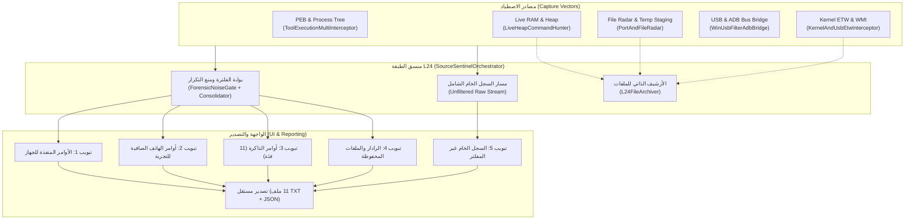

# دليل مرجعي شامل: الطبقة 24 (L24_SourceSentinel - Phoenix OmniTrace)
## Comprehensive Architecture & Reference Guide for Layer 24

---

## 📌 1. نظرة عامة (Overview)

تُمثل **الطبقة 24 (L24 - SourceSentinel)** القلب النابض لمنظومة التحليل الجنائي والاستخباراتي لأدوات صيانة المحمول (GSM Tools) داخل منصة **PhoenixGSM**.
هدف هذه الطبقة هو **الاعتراض المباشر للأوامر والعمليات من المصدر (Source-Level Interception)** قبل التشفير، وأثناء التنفيذ، ومن الذاكرة الحية (RAM & Dynamic Heap)، وعلى مستوى الكيرنل (ETW & WinUSB)، بالإضافة إلى الأرشفة التلقائية اللحظية لملفات البوت واللودرات (DA, Firehose, IMG4/IM4P, Scatter, PIT, PAC).

تمت إعادة هيكلة وتقسيم الملفات الكبيرة في هذه الطبقة وفق أحدث معايير هندسة البرمجيات (Clean Architecture, High Cohesion, Loose Coupling, Single Responsibility Principle) لتسهيل وتسريع الصيانة والتطوير المستقبلي دون أي تغيير في الواجهات البرمجية (Public APIs) أو التوافق الثنائي (Binary Compatibility).

---

## 🏗️ 2. مقارنة الهيكلية قبل وبعد إعادة التقسيم (Before vs. After)

### 🔴 قبل التقسيم (Monolithic State):
كانت الطبقة تعاني من وجود ملفات عملاقة متضخمة يصعب فحصها وتعديلها:
- `SourceSentinelOrchestrator.cs` (1,375 سطر): كان يحتوي على المنسق العام + كلاس الاعتراض المتعدد `ToolExecutionMultiInterceptor` بداخل نفس الملف!
- `SourceSentinelViewModel.cs` (1,217 سطر): كان يدمج إدارة الواجهة + دوال التصدير الـ 11 + فلترة التبويبات + أوامر `RelayCommand` ومربعات الحوار.
- `LiveHeapCommandHunter.cs` (1,062 سطر): كان يدمج محرك قراءة الذاكرة + كافة تعبيرات Regex الـ 11 + معالجة وتطهير النصوص + قنص ملفات البوت.
- `ForensicNoiseGate.cs` (692 سطر): كان يدمج أرشيف الملفات `L24FileArchiver` + مدمج بافرات الرام `RamCommandConsolidator` + بوابة الضوضاء.
- `SourceTelemetryEvent.cs` (516 سطر): كان يدمج الـ Enums الأربعة + مصنف الفئات `L24CommandClassifier` + كلاس الحدث.

---

### 🟢 بعد التقسيم (Modular Architecture):

```
PhoenixOmniTrace\L24_SourceSentinel\
├── Core\
│   ├── SourceSentinelOrchestrator.cs                # المنسق العام، الخصائص الأساسية ودورة الحياة
│   ├── SourceSentinelOrchestrator.ProcessManager.cs # إدارة تشغيل الأدوات والربط بالعمليات (PID)
│   ├── SourceSentinelOrchestrator.Logging.cs        # مسارات السجلات الخام وتصدير اللقطات
│   ├── ToolExecutionMultiInterceptor.cs             # محرك الاعتراض المستقل (PEB, CLI, Sockets, Pipes)
│   ├── LiveHeapCommandHunter.cs                     # فاحص الرام، الـ Chunk Cache، وبصمة الخمول
│   ├── LiveHeapCommandHunter.Scanner.cs             # فاحص شرائح البايتات وقانص ملفات البوت بالرام
│   ├── LiveHeapPatterns.cs                          # التعبيرات النمطية الـ 11 ودوال تنظيف النصوص
│   ├── ForensicNoiseGate.cs                         # بوابة التصفية الجنائية واستبعاد الموديولات
│   ├── RamCommandConsolidator.cs                    # دمج الأجزاء المتكررة في نفس حي الذاكرة
│   ├── L24FileArchiver.cs                           # الأرشيف الفوري لحفظ ملفات البوت واللودر
│   ├── ActiveComAndUsbPortPoller.cs                 # مستطلع المنافذ التسلسلية ومنافذ USB
│   ├── KernelAndUsbEtwInterceptor.cs                # معترض الكيرنل عبر جلسات ETW و WMI
│   ├── WinUsbFilterAdbBridge.cs                     # جسر اعتراض WinUSB و ADB
│   ├── PortAndFileRadar.cs                          # رادار مراقبة المجلدات والمنافذ
│   ├── RamAndModuleWatcher.cs                       # مراقب الموديولات المحملة بالذاكرة
│   ├── DllFunctionTableAuditor.cs                   # مدقق جدول تصدير واستيراد الدوال
│   └── OriginAttributionEngine.cs                   # محرك تتبع وعزو الأوامر للأدوات
│
├── Models\
│   ├── SentinelEnums.cs                             # تعريفات الحالات والنطاقات والأوضاع
│   ├── L24CommandClassifier.cs                      # قواعد تصنيف الأوامر إلى 10 فئات استخباراتية
│   ├── SourceTelemetryEvent.cs                      # نموذج بيانات الحدث الجنائي الكامل
│   ├── LoadedModuleArtifact.cs                      # مخرجات الموديولات والمكتبات المرصودة
│   └── TrackedHandleInfo.cs                         # تفاصيل المقابض والمنافذ النشطة
│
├── Decoders\
│   ├── RawPayloadClassifier.cs                      # تصنيف الحمولات الثنائية
│   └── SerialIoControlDecoder.cs                    # مفكك أوامر IOCTL للمنافذ التسلسلية
│
├── NativeProbe\
│   ├── PhoenixSourceProbe.cpp                       # مسبار الحقن والمراقبة المحلي (C++)
│   ├── PhoenixSourceProbe.h                         # ترويسة المسبار
│   ├── CMakeLists.txt                               # ملف بناء المسبار
│   └── build_probe.bat                              # سكربت الترجمة
│
└── UI\
    ├── SourceSentinelViewModel.cs                   # الخصائص والمجموعات وحلقات استقبال الأحداث
    ├── SourceSentinelViewModel.Filtering.cs         # قواعد الفلترة للتبويبات الـ 5 والفئات الـ 11
    ├── SourceSentinelViewModel.Export.cs            # دوال تصدير التقارير (JSON/TXT/مجلدات منفصلة)
    ├── SourceSentinelViewModel.Commands.cs          # أوامر RelayCommand ومربعات الحوار
    ├── SourceSentinelResources.xaml                 # قوالب الأزرار والمؤشرات والأنماط البصرية
    ├── SourceSentinelControl.xaml                   # واجهة التحكم والمراقبة التفاعلية الرئيسية
    ├── SourceSentinelControl.xaml.cs                # الشفرة الخلفية للواجهة
    ├── SourceSentinelWindow.xaml                    # نافذة التشغيل المستقلة
    └── SourceSentinelWindow.xaml.cs                 # الشفرة الخلفية للنافذة المستقلة
```

---

## 🧩 3. التفصيل المرجعي للمكونات (Component Reference)

### 3.1 النواة والتنسيق العام (Core Orchestration)

#### 1. `SourceSentinelOrchestrator.cs`
- **الوظيفة**: المنسق الأعلى لكافة مكونات الطبقة 24.
- **المسؤوليات**:
  - تهيئة الحساسات الداخلية (`NetworkUrlSensor`, `ClipboardUrlSensor`, `TempFileAtSensor`, إلخ).
  - توجيه الأحداث الملتقطة عبر مسارين: المسار الخام غير المفلتر (`RecordUnfilteredRawEvent`)، والمسار المنظم المفلتر عبر `ForensicNoiseGate`.
  - إدارة دورة الحياة (`Start`, `Stop`, `Dispose`).
  - دعم ربط ناقل البيانات الخارجي `OmniTraceEventBus`.

#### 2. `SourceSentinelOrchestrator.ProcessManager.cs`
- **الوظيفة**: إدارة العمليات المفحوصة.
- **المسؤوليات**:
  - `AutoDiscoverGsmToolsLoop`: الاستكشاف التلقائي لعمليات أدوات GSM المعروفة (مثل UnlockTool, Chimera, Miracle, DFTPro, Pandora, Z3X, إلخ).
  - `LaunchAndInterceptTool`: تشغيل الأداة في بيئة مراقبة وتفعيل اصطياد مسارات العمل.
  - `AttachToRunningProcess`: الارتباط الفوري بعملية قيد التشغيل بواسطة الـ PID.

#### 3. `SourceSentinelOrchestrator.Logging.cs`
- **الوظيفة**: إدارة عمليات التدوين اللحظي والحفظ على القرص الصلب.
- **المسؤوليات**:
  - `DiskLoggerLoop`: كتابة أحداث الجلسة المنظمة في ملفات `.json` و `.jsonl`.
  - `UnfilteredRawDiskLoggerLoop`: تسجيل السجل الشامل الخام لكل بايت وأمر يتم اعتراضه في ملف نصي وتنسيق JSONL.
  - `FlushAndExportSessionSnapshot`: حفظ فوري لجميع أحداث الجلسة.

---

### 3.2 محركات الاعتراض واصطياد الذاكرة (Interception & Memory Hunters)

#### 4. `ToolExecutionMultiInterceptor.cs`
- **الوظيفة**: اعتراض الأوامر الصادرة من الأدوات قبل وأثناء وصولها إلى النظام.
- **المتجهات المغطاة**:
  - **PEB Fast Command Line Sniffer**: فحص شجرة العمليات والتقاط سطور الأوامر لبرامج CLI (مثل `adb`, `fastboot`, `fh_loader`, `qsahara_server`, `irecovery`, `7z`, إلخ).
  - **Interactive ConPTY / Sockets**: مراقبة بافرات المقابس وجلسات الطرفيات التفاعلية.
  - **Staging Watchers**: مراقبة المجلدات المؤقتة وحفظ السكربتات المرحلية (`.bat`, `.cmd`, `.ps1`, `.sh`, `.xml`).
  - **Named Pipe Radar**: اصطياد قنوات الاتصال الداخلية التي تنشئها الأدوات.

#### 5. `LiveHeapCommandHunter.cs` & `LiveHeapCommandHunter.Scanner.cs`
- **الوظيفة**: المسح الذكي الفائق للذاكرة اللحظية (RAM) والـ Dynamic Heap دون التسبب بأي بطء للأداة.
- **المزايا المتقدمة**:
  - **Dirty-Chunk Hash Cache**: استخدام خوارزمية FNV-1a سريعة لتخطي الشرائح غير المتغيرة، مما يحقق تسريعاً بنسبة 30x مقارنة بالفحص التقليدي.
  - **Idle Baseline Suppression**: أخذ بصمة نصوص وضع الخمول (Idle Snapshot) لعزل النصوص الثابتة داخل ملف الـ EXE وإظهار الأوامر المولدة فقط.
  - **In-Memory Boot Loader Carver**: اصطياد واستخراج ملفات البوت (MediaTek DA, Apple IMG4/IM4P) مباشرة من صفحات الذاكرة وحفظها تلقائياً.

#### 6. `LiveHeapPatterns.cs`
- **الوظيفة**: تجميع مركزي لكافة القواعد والتعبيرات النمطية الـ 11:
  1. `StrictAtCommandRegex`: أوامر المودم و RIL IPC.
  2. `MtkProtocolRegex`: بروتوكولات وأوامر MediaTek BROM و DA.
  3. `DeepAdbAndShellRegex`: أوامر ADB و Fastboot وقذائف Shell.
  4. `QualcommCommandRegex`: أوامر كوالكوم EDL و Sahara و Firehose XML.
  5. `AppleIosRamRegex`: أوامر وبروتوكولات أجهزة Apple في أطوارها الـ 7.
  6. `CloudAndServerUrlRegex`: الروابط واستدعاءات الخوادم السحابية.
  7. `LoginAndServerAuthRegex`: عمليات تسجيل الدخول والتوكن والمصادقة.
  8. `FileTransferAndLoaderRegex`: أوامر نقل ورفع وتجهيز ملفات البوت.
  9. `ArchiveAndUnpackCommandRegex`: أوامر فك الضغط وتفكيك صور الفيرموير.
  10. `CryptoAndDecryptionCommandRegex`: عمليات التشفير وفك التشفير والمفاتيح الأمنية.
  11. `OdinSpdAndOtherRegex`: بروتوكولات سامسونج أودين وسبريدترم ومسارات النظام.

---

### 3.3 الأرشفة وتصفية الضوضاء (Archiving & Noise Reduction)

#### 7. `L24FileArchiver.cs`
- **الوظيفة**: أرشيف الحفظ الذاتي التلقائي لكافة الملفات المستخرجة.
- **المسؤوليات**:
  - حفظ الملفات المحملة مع حساب بصمة SHA-256 لمنع التكرار.
  - كتابة ملف تعريفي إضافي `.meta.txt` لكل ملف محفوظ يحتوي على تاريخ الحفظ، المصدر، الحجم، والهاش.

#### 8. `ForensicNoiseGate.cs` & `RamCommandConsolidator.cs`
- **الوظيفة**: فلترة الشوائب والضوضاء الناتجة عن موديولات النظام (Qt5, Windows DLLs) ومطابقة الأوامر.
- **المسؤوليات**:
  - منع تكرار الأوامر المتشابهة في نفس حي الذاكرة (Memory Neighborhood Consolidation).
  - التحقق من نقاء النصوص المطبوعة (ASCII/UTF-8 Validation).
  - التحكم في إظهار أو إخفاء ردود الهاتف.

---

### 3.4 نماذج البيانات والتصنيف (Models & Classification)

#### 9. `SentinelEnums.cs`
- يحتوي على التعدادات:
  - `SentinelStage`: مراحل التحليل الجنائي (RAM, Radar, Local File, Port, Raw Command, Network).
  - `L24CommandScope`: النطاق (منفذ للجهاز، مكتشف بالرام، رادار وملفات).
  - `L24DiscoveryMode`: وضع الاكتشاف (أوامر منفذة فقط، أوامر هاتف بالرام، شامل).
  - `L24CommandGroup`: الفئات الـ 10 للأوامر.

#### 10. `L24CommandClassifier.cs`
- يحتوي على منطق تصنيف الأحداث:
  - `DetermineScope`: عزل الروابط والعمليات تلقائياً إلى نطاقها الصحيح.
  - `DetermineGroup`: تصنيف الأوامر الصافية استناداً إلى المحتوى والكلمات المفتاحية.
  - `IsPurePhoneTestable`: استخراج الأوامر الصافية الجاهزة للتجربة المباشرة على الأجهزة.

#### 11. `SourceTelemetryEvent.cs`
- الكيان الأساسي للحدث الجنائي متضمناً كامل التفاصيل: ProcessId, ThreadId, HookedApi, CallerOrigin, TargetResource, PureCommandText, RawPayloadHex, SavedFilePath.

---

### 3.5 واجهة المستخدم والـ MVVM (UI Subsystem)

تم تقسيم `SourceSentinelViewModel` إلى 4 ملفات متناسقة:
1. `SourceSentinelViewModel.cs`: الخصائص والمجموعات وحلقات المزامنة مع واجهة WPF.
2. `SourceSentinelViewModel.Filtering.cs`: منطق التصفية وعرض التبويبات الـ 5 (المنفذة، أوامر التجربة، مكتشفات الرام، الرادار والملفات، السجل الخام غير المفلتر).
3. `SourceSentinelViewModel.Export.cs`: خيارات التصدير (تصدير كلي، تصدير فئة محددة، تصدير 11 فئة في مجلدات وملفات مستقلة TXT و JSON).
4. `SourceSentinelViewModel.Commands.cs`: الربط بالأوامر (`RelayCommand`) ومربعات الحوار.
5. `SourceSentinelResources.xaml`: تجميع الأنماط البصرية والألوان لسهولة التعديل.

---

## 🔄 4. مخطط تدفق البيانات الجنائية (Forensic Data Flow)



---

## 🛠️ 5. دليل المطورين للصيانة والإضافة (Developer's Extension Guide)

### 🔹 إضافة تعبير نمطي (Regex) جديد لأداة أو معالج جديد:
1. افتح الملف [`LiveHeapPatterns.cs`](file:///tools/MonitoringToolkit/PhoenixOmniTrace/L24_SourceSentinel/Core/LiveHeapPatterns.cs).
2. أضف التعبير الجديد أو حدث التعبيرات القائمة.
3. توجه إلى [`LiveHeapCommandHunter.Scanner.cs`](file:///tools/MonitoringToolkit/PhoenixOmniTrace/L24_SourceSentinel/Core/LiveHeapCommandHunter.Scanner.cs) في دالة `ScanStringContent` لتحديد كيفية استخراج الحدث وإطلاقه.

### 🔹 إضافة نمط تصنيف جديد أو فئة جديدة:
1. إذا تطلب الأمر فئة جديدة، أضفها إلى `L24CommandGroup` في [`SentinelEnums.cs`](file:///tools/MonitoringToolkit/PhoenixOmniTrace/L24_SourceSentinel/Models/SentinelEnums.cs).
2. عدل دالة `DetermineGroup` و `GetGroupArabicTitle` في [`L24CommandClassifier.cs`](file:///tools/MonitoringToolkit/PhoenixOmniTrace/L24_SourceSentinel/Models/L24CommandClassifier.cs).
3. أضف الفلتر والعداد المقابل في [`SourceSentinelViewModel.Filtering.cs`](file:///tools/MonitoringToolkit/PhoenixOmniTrace/L24_SourceSentinel/UI/SourceSentinelViewModel.Filtering.cs).

### 🔹 تعديل استبعاد ملفات النظام أو الضوضاء:
- لإضافة مكتبة جديدة إلى قائمة الاستبعاد، أضف اسم المكتبة إلى `ExcludedNoiseModules` في [`ForensicNoiseGate.cs`](file:///tools/MonitoringToolkit/PhoenixOmniTrace/L24_SourceSentinel/Core/ForensicNoiseGate.cs).

---
*تم إعداد هذا الدليل المرجعي كمرجع رسمي وشامل بعد اكتمال إعادة هيكلة وتقسيم الطبقة 24 بنجاح.*
